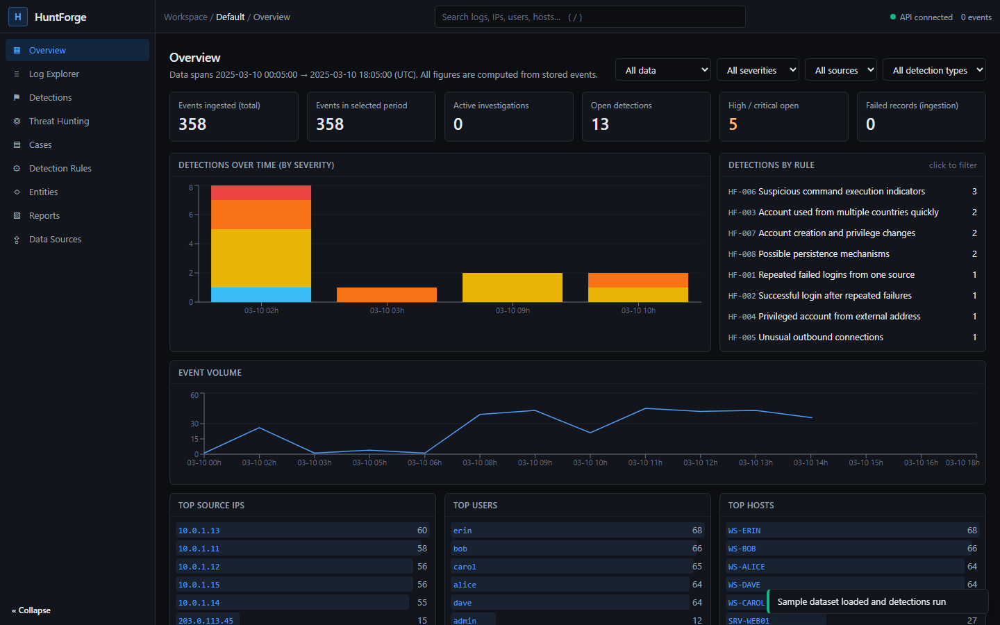
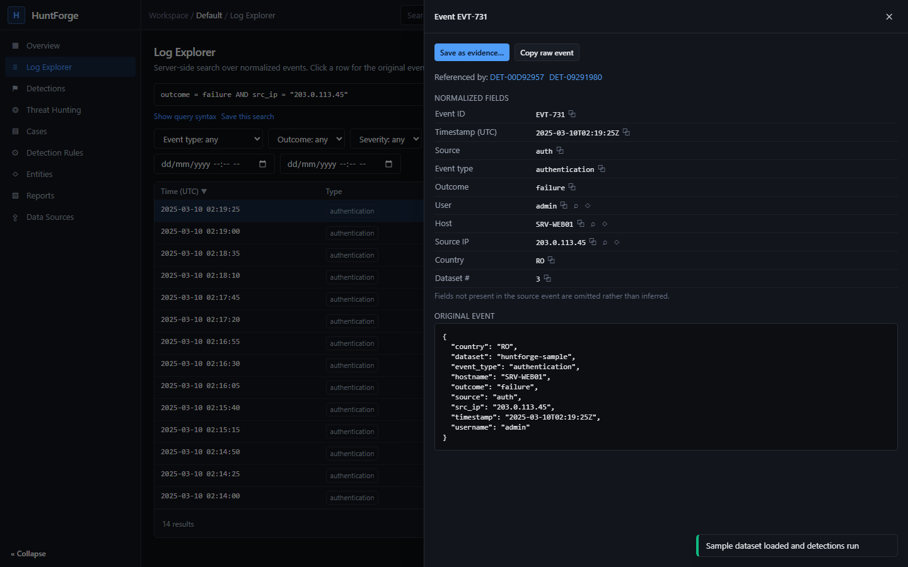
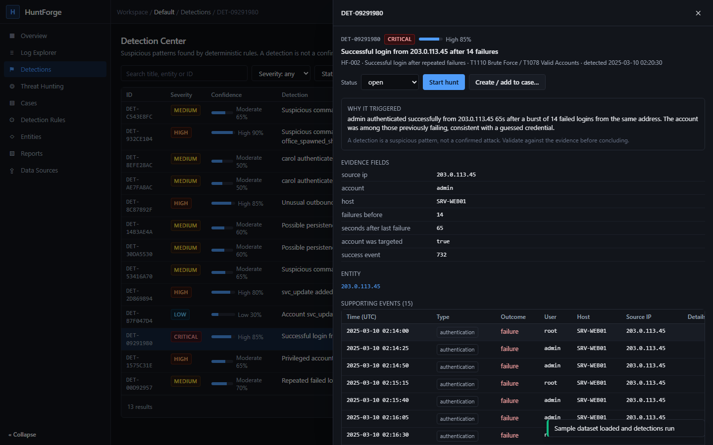
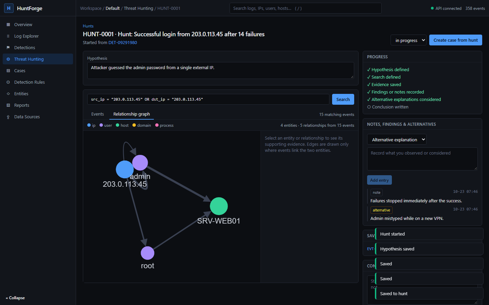
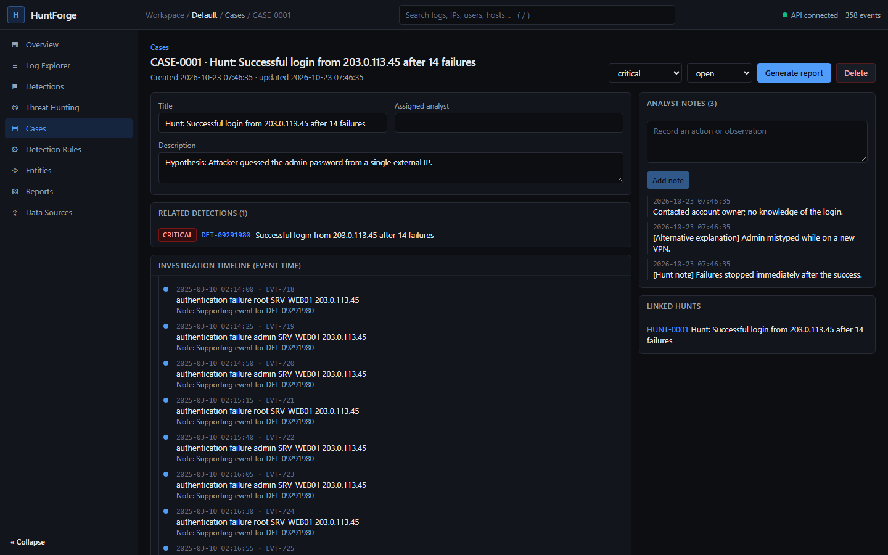
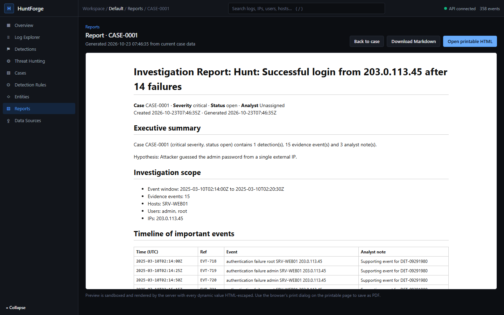
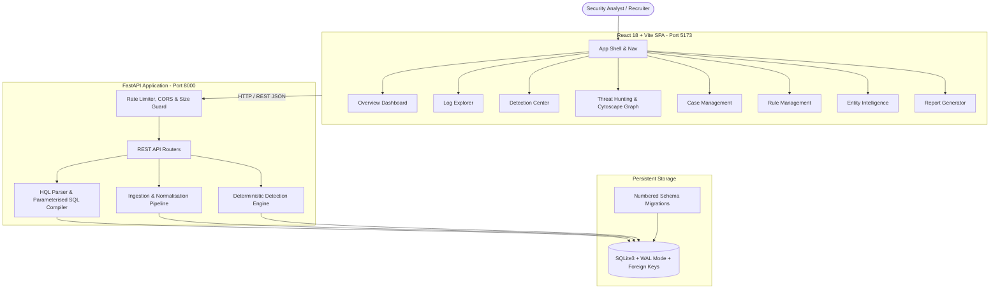

# HuntForge — Threat Hunting & Investigation Workbench

[](#)
[](backend/)
[](frontend/)
[](#testing)
[](#detection-engine)
[](#)

> **Live Frontend Deployment:** [https://huntforge-seven.vercel.app](https://huntforge-seven.vercel.app)  
> **Source Repository:** [https://github.com/GorillaBrain/huntforge](https://github.com/GorillaBrain/huntforge)

**HuntForge** is a full-stack defensive threat hunting and security investigation platform designed for SOC analysts, detection engineers, and incident responders. It provides high-performance log ingestion, canonical normalization, safe parameterised querying via the **Hunt Query Language (HQL)**, a deterministic detection engine, a hypothesis-driven threat hunting workspace with interactive entity relationship graphs, persistent case management, and evidence-backed report exports.

The foundational design principle of HuntForge is:  
**Every detection must be explainable, every investigation must preserve evidence, and every major interface must perform a real function.**

---

## Screenshots

| Overview Operations Dashboard | Interactive Log Explorer & Event Inspector |
| :---: | :---: |
|  |  |
| *Real-time metrics, detection volume by severity, event rate, top entities* | *Server-side HQL query, structured facets, normalized fields & original event* |

| Detection Center & Explainable Findings | Threat Hunting Workspace & Relationship Graph |
| :---: | :---: |
|  |  |
| *Explainable rule triggers, severity vs. confidence, supporting events* | *Hypothesis tracking, query pivots, interactive entity relationship topology* |

| Persistent Investigation Cases | Evidence-Backed Printable Reports |
| :---: | :---: |
|  |  |
| *Event timeline reconstruction, notes, immutable evidence snapshots* | *Executive summary, scope, timeline, findings, HTML-escaped CSP layout* |

---

## Core Capabilities

### 1. High-Performance Log Ingestion & Canonical Schema
- **Supported Formats:** JSON arrays, newline-delimited JSON (NDJSON/JSONL), and standard Linux/BSD `sshd` authentication syslog entries.
- **Normalization Engine:** Maps diverse telemetry to a documented schema (`ts`, `source`, `event_type`, `outcome`, `severity`, `src_ip`, `dst_ip`, `dst_port`, `username`, `hostname`, `process_name`, `parent_process`, `command_line`, `domain`, `bytes_out`, `country`, `message`).
- **Data Integrity:** Missing fields remain `NULL` (never fabricated). Every event retains its untouched `raw` payload.
- **Safe Parsing:** Streamed validation with file-size boundaries (10 MB default), UTF-8 verification, binary payload rejection, and SHA-256 deduplication to prevent duplicate ingestion.

### 2. Safe Hunt Query Language (HQL)
- **Safe AST Compilation:** Recursive-descent compiler converts user queries into parameterised SQL. **No string interpolation into SQL queries.**
- **Expressive Syntax:** Supports boolean operations (`AND`, `OR`, `NOT`), grouping parentheses `()`, comparison operators (`=`, `!=`, `>`, `<`, `>=`, `<=`), substring searches (`~`, `contains`), wildcard matching (`*`), and bare terms across all searchable columns.
- **Query Builder:** Built-in visual condition builder for analysts who prefer structured forms.
- **Saved Searches:** Save and execute frequently used search routines directly from the explorer.

### 3. Deterministic Detection Engine
- **8 Curated Analytic Rules:**
  1. `HF-001`: **Repeated failed logins from one source** (T1110 Brute Force)
  2. `HF-002`: **Successful login after repeated failures** (T1110 / T1078 Valid Accounts)
  3. `HF-003`: **Account used from multiple countries quickly** (T1078 Valid Accounts)
  4. `HF-004`: **Privileged account from external address** (T1078.002 / T1078.003)
  5. `HF-005`: **Unusual outbound connections** (T1071 Application Protocol / T1041 Exfiltration)
  6. `HF-006`: **Suspicious command execution indicators** (T1059 Command & Scripting Interpreter / T1204 User Execution)
  7. `HF-007`: **Account creation and privilege changes** (T1136 Create Account / T1098 Account Manipulation)
  8. `HF-008`: **Possible persistence mechanisms** (T1053 Scheduled Task / T1547 Boot or Logon Autostart)
- **Severity vs. Confidence:** Represents severity (potential impact) and confidence (likelihood of true positive) as independent concepts.
- **Traceable Evidence:** Every detection retains explicit foreign-key links to its supporting event records.
- **Rule Lifecycle:** Enable/disable rules, tune parameters (e.g. thresholds, time windows, port allowlists), run dry-runs, and run automated verification against the sample dataset.

### 4. Hypothesis-Driven Threat Hunting Workspace
- **Investigation Loop:** Formulate hypotheses, execute iterative queries, pivot on observed values, save evidence, record findings and alternative hypotheses, and mark conclusions.
- **Interactive Relationship Graph:** Cytoscape-powered directional graph rendered from actual co-occurrences in the matching events (User ↔ Host ↔ Source IP ↔ Destination IP ↔ Domain ↔ Process).
- **One-Click Case Promotion:** Seamlessly promote an active hunt into an official incident investigation case, carrying over all notes and evidence.

### 5. Persistent Case Management & Reporting
- **Persistent Investigation State:** Cases, evidence snapshots, timeline entries, analyst notes, and conclusions persist across browser sessions.
- **Immutable Evidence Snapshots:** Evidence items store point-in-time snapshots of event records, preserving fidelity even if raw logs are purged.
- **Export Options:** Generates standardized GitHub-flavored Markdown (`.md`) reports and self-contained, CSP-hardened printable HTML reports with zero external network dependencies.

### 6. Entity Intelligence
- Searchable directory of observed entities across **IP Addresses**, **Users**, **Hosts**, **Domains**, and **Processes**.
- Explicit boundary separating observed local facts from external threat intelligence.

---

## Architecture Overview



---

## Technology Stack

| Layer | Technology | Rationale |
| :--- | :--- | :--- |
| **Frontend** | React 18, TypeScript, Vite 5 | Fast HMR, strong typing, clean component architecture |
| **Styling** | Tailwind CSS 3 | Bespoke security-dark theme (`#0c0e12`), accessible contrast, compact tables |
| **Visualisation** | Recharts 2, Cytoscape 3 | Responsive time-series charts, vector entity-relationship graphs |
| **Backend** | Python 3.12+, FastAPI, Pydantic v2 | High-throughput asynchronous REST API, strict request/response validation |
| **Query Engine** | Custom HQL Lexer & Recursive-Descent AST | Safe parameterised SQL generation without SQL injection risk |
| **Database** | SQLite 3 with WAL Mode & Foreign Keys | Zero-configuration local development, fully reproducible numbered migrations |
| **Testing** | Pytest, Vitest, Playwright | Backend integration tests, frontend component tests, and end-to-end browser workflows |
| **Deployment** | Vercel (Frontend), Docker / Render (Backend) | Cost-effective, production-grade cloud deployment |

---

## Local Setup & Quickstart

### Prerequisites
- **Node.js** v20+ and `npm`
- **Python** 3.11+
- **Git**

### 1. Clone the Repository
```bash
git clone https://github.com/GorillaBrain/huntforge.git
cd huntforge
```

### 2. Backend Setup
```bash
cd backend
python -m venv .venv

# On Windows (PowerShell):
.\.venv\Scripts\Activate.ps1
# On Linux / macOS:
# source .venv/bin/activate

pip install -r requirements-dev.txt

# Run migrations and start the backend on port 8000
python -m uvicorn app.main:app --port 8000 --reload
```
Interactive API documentation is now available at: [http://127.0.0.1:8000/docs](http://127.0.0.1:8000/docs).

### 3. Frontend Setup
Open a second terminal window:
```bash
cd frontend
npm install

# Start the Vite dev server with proxy to backend (port 5173)
npm run dev
```
Open your browser at: [http://localhost:5173](http://localhost:5173).

### 4. Load Synthetic Demo Data
When you open HuntForge for the first time, click **"Load synthetic sample dataset"** on the Overview page or in Data Sources. This loads:
- Normal authentication, DNS, network, and process events for multiple users.
- A brute force attack against an SSH server followed by an administrator credential compromise.
- Subsequent lateral privilege escalation, suspicious encoded PowerShell execution, scheduled task persistence, and outbound data exfiltration.
- All metrics, detection rules, relationship graphs, and entity profiles populate with consistent, linked data.

---

## Testing & Verification

HuntForge includes full test coverage across all layers:

### 1. Backend Automated Tests (37 tests)
Runs query compilation, injection safety, ingestion parsing, detection rules, expected detections, and API workflows:
```bash
cd backend
.\.venv\Scripts\pytest -v
```

### 2. Frontend Component & Unit Tests (9 tests)
Runs Vitest and React Testing Library tests for client components, empty states, and API error formatting:
```bash
cd frontend
npm test
```

### 3. Browser End-to-End Tests with Playwright (5 suites)
Executes end-to-end workflows in a headless Chromium browser and generates documentation screenshots:
```bash
cd e2e
npx playwright test
```

---

## Environment Variables

Copy `.env.example` to configure your environment:

### Backend Options
| Variable | Default | Purpose |
| :--- | :--- | :--- |
| `HUNTFORGE_DB_PATH` | `./data/huntforge.db` | File path for SQLite database |
| `HUNTFORGE_CORS_ORIGINS` | `http://localhost:5173` | Comma-separated list of permitted CORS origins |
| `HUNTFORGE_MAX_UPLOAD_MB` | `10` | Maximum file upload size in megabytes |
| `HUNTFORGE_MAX_EVENTS` | `100000` | Maximum records allowed in a single upload |
| `HUNTFORGE_RATE_LIMIT` | `600` | Requests allowed per minute per client IP |
| `HUNTFORGE_LOG_LEVEL` | `INFO` | Logging level (`DEBUG`, `INFO`, `WARNING`, `ERROR`) |

### Frontend Options
| Variable | Default | Purpose |
| :--- | :--- | :--- |
| `VITE_API_URL` | `""` (proxied to `/api`) | Public HTTPS base URL of backend in production |

---

## Deployment Guide

### Deploying Frontend to Vercel
The frontend is pre-configured for Vercel deployment with `vercel.json`:
1. Push your repository to GitHub.
2. In the Vercel dashboard, import the `huntforge` repository.
3. Configure the project settings:
   - **Framework Preset:** Other
   - **Root Directory:** `./`
   - **Build Command:** `cd frontend && npm ci && npm run build`
   - **Output Directory:** `frontend/dist`
4. Set the Environment Variable:
   - `VITE_API_URL`: Your deployed backend URL (e.g., `https://huntforge-api.onrender.com`).
5. Deploy. SPA rewrites and security headers (`nosniff`, `DENY`, `strict-origin-when-cross-origin`, CSP) are applied automatically.

### Deploying Backend to Render / Docker
A production `Dockerfile` and `render.yaml` are provided in the repository:
1. Connect your repository to Render as a Web Service.
2. Select **Docker** environment using `backend/Dockerfile`.
3. Add a persistent disk mounted at `/app/data` to ensure the SQLite database persists across service restarts.
4. Set environment variables:
   - `HUNTFORGE_CORS_ORIGINS`: `https://huntforge-seven.vercel.app`
   - `HUNTFORGE_DB_PATH`: `/app/data/huntforge.db`
5. The `/api/health` endpoint serves as the health-check target.

---

## Security Considerations

1. **Parameterised Database Queries:** All SQL queries use strictly parameterised inputs. The HQL engine compiles user query ASTs into SQL parameter arrays and rejects unwhitelisted fields.
2. **Formula Injection Mitigation:** CSV exports automatically prepend a single quote `'` to cells beginning with `=`, `+`, `-`, `@`, `\t`, or `\r` to prevent spreadsheet command execution.
3. **Strict Content-Security-Policy:** Report previews run in sandboxed iframes. HTML reports generated by the backend enforce `default-src 'none'; style-src 'unsafe-inline'` and HTML-escape all user-provided strings.
4. **Input Size & Rate Limits:** Request bodies and uploads are limited in size (10 MB default) and client requests are rate-limited to prevent denial of service.
5. **No Embedded Secrets:** Zero secrets or API keys are stored in source code or frontend bundles.

---

## License

This project is licensed under the MIT License. See [LICENSE](LICENSE) for details.
